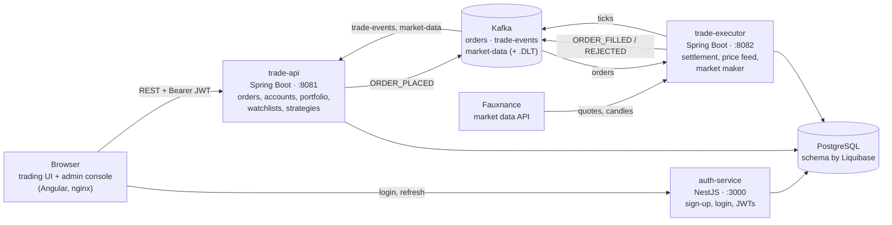

# Ferodha

**An enterprise trading platform for US and Indian equities**: live prices, limit
orders settled through Kafka, a portfolio with profit and loss, watchlists with
price alerts, automated strategies, bank transfers, and an operations console. It
runs as four services on PostgreSQL and Kafka, ships as Docker images, and deploys
to Kubernetes (Amazon EKS) through a Jenkins CI/CD pipeline behind CloudFront.


Built by Team 2 (Chennai, SE4) as the Neueda LEAP capstone. No real money is traded.

---

## Contents

- [What it does](#what-it-does)
- [Architecture](#architecture)
- [Tech stack](#tech-stack)
- [Repository layout](#repository-layout)
- [Run it locally](#run-it-locally)
- [Tests](#tests)
- [Deployment](#deployment)
- [Engineering practices](#engineering-practices)
- [Configuration](#configuration)
- [Learning from this repository](#learning-from-this-repository)

## What it does

**For customers** (the trading UI, `http://localhost:4200`):

- Sign up with email verification; an administrator approves the account.
- Browse the market: search, filter, live quotes, price history charts and a trend signal.
- Place limit orders with the cost and fee shown before sending; follow each order from
  placed to filled or rejected (with the reason), and cancel one still in process.
- See cash, positions, today's and total profit and loss.
- Keep watchlists with sparklines and price alerts (in-app or email).
- Run strategies that place orders when a price reaches a level, with a dry-run mode.
- Move money between a linked bank account and the trading account.
- Light and dark themes, number formats, hidden balances; works on phones.

**For operators** (the console, `http://localhost:4200/admin`): approve account
requests, suspend or reactivate users, browse accounts, orders and instruments, review
fees and the audit log, and watch the health of every service.

## Architecture



**How an order travels**

1. The UI sends `POST /api/v1/orders` with the user's JWT and an `Idempotency-Key`.
   trade-api verifies the token locally (no call to auth-service), checks the business
   rules, reserves the cash and stores the order as `NEW`.
2. It publishes `ORDER_PLACED` to the `orders` topic.
3. trade-executor consumes it, prices it at the live tick (or matches it on an order book
   under the `market-sim` profile), and settles cash and positions in one transaction.
   The update is conditional, so a redelivered message never settles twice.
4. It publishes `ORDER_FILLED` or `ORDER_REJECTED` to `trade-events`; trade-api turns
   that into a notification, and the UI shows the new status.
5. A message that keeps failing goes to the topic's `.DLT` (dead-letter topic) instead of
   blocking the partition.

The reasons behind each of these choices are in [`decision-log/`](decision-log/README.md).

## Tech stack

| Layer | Technology |
|---|---|
| Trading UI, admin console | Angular 21 (standalone components, signals), ag-Grid, Chart.js; served by nginx |
| Trade API | Java 21, Spring Boot 3.5, MyBatis, Liquibase, Spring Kafka |
| Trade executor | Java 21, Spring Boot 3.5, Spring Kafka, scheduled price feed |
| Auth service | NestJS 11 (TypeScript), node-postgres, JWT access and rotating refresh tokens, bcrypt |
| Messaging | Apache Kafka 3.8 in KRaft mode, dead-letter topics |
| Database | PostgreSQL 16 (AWS RDS in the cloud) |
| Analytics | Python ETL into a DuckDB warehouse ([`etl/`](etl/README.md)) |
| Contracts | OpenAPI 3.1 ([`contracts/`](contracts/)); the UI's API clients are generated from them |
| Containers | Docker, Docker Compose |
| Cloud | Amazon EKS (Kubernetes), ECR, RDS, CloudFront, Route 53 |
| CI/CD | Jenkins (build and push images; deploy a chosen tag) |
| Quality | pre-commit (gitleaks, shellcheck, ESLint/Prettier), JUnit, Vitest, Playwright, Bruno |

## Repository layout

| Path | What is there |
|---|---|
| [`trade_api/`](trade_api/README.md) | Trade REST API. Liquibase changelogs in `src/main/resources/db/changelog/` |
| [`trade_executor/`](trade_executor/README.md) | Order settlement, the price feed (`ticker`) and the market maker (`marketmaker`) |
| [`auth_service/`](auth_service/README.md) | Registration, email codes, login, refresh, admin users |
| `trading-ui/` | The trading UI (`src/`) and the admin console (`projects/admin/`) in one Angular workspace |
| [`contracts/`](contracts/) | The OpenAPI contracts and design write-ups ([index](contracts/docs/README.md)) |
| [`decision-log/`](decision-log/README.md) | Architecture decision records: context, options, decision, consequences |
| [`k8s/`](k8s/README.md) | Kubernetes manifests for EKS and the manual runbook |
| [`cloudfront/`](cloudfront/README.md) | HTTPS on one address through CloudFront |
| `JenkinsfileCI`, `JenkinsfileCD` | The two Jenkins pipelines |
| `docker-compose.yml` | The whole platform on one machine |
| [`database/`](database/README.md) | Base schema, seed data, integrity probes, DuckDB migrations |
| [`etl/`](etl/README.md) | The analytics pipelines |
| [`kafka_pipeline/`](kafka_pipeline/README.md) | Topic and dead-letter topic creation scripts |
| [`java_module/`](java_module/README.md) | The original domain model and UML diagrams (copied into trade_api) |
| [`bruno/`](bruno/bruno-collection.md) | An API collection that exercises the auth service end to end |
| [`scripts/`](scripts/README.md) | `demo.sh`: brings the stack up and walks every endpoint |
| [`windows/`](windows/README.md) | Services natively on Windows, Kafka in Docker on Linux |
| [`production-security/`](production-security/README.md) | Scans of the production UI bundle for leaked secrets |
| [`story_docs/`](story_docs/) | Extension stories and every departure from the course contracts |

## Run it locally

**Needs:** Docker with Compose, and a Fauxnance (market data API) URL and key for live prices.

```bash
cp .env.example .env        # set POSTGRES_*, JWT_SECRET, FAUXNANCE_API_URL, FAUXNANCE_API_KEY
docker compose up -d --build
```

| Open | Sign in as (password `seed-password-change-me`) |
|---|---|
| http://localhost:4200 | `john.carter@example.com` (customer) |
| http://localhost:4200/admin | `michael.brown@example.com` (administrator) |

A newly registered user has no account until an administrator approves it in the
console. Without SMTP settings, sign-up codes are written to the auth-service log
(`docker compose logs auth-service | grep -i code`).

`./scripts/demo.sh` does the same and then walks the auth service and every trade-api
endpoint with real tokens (`--fresh` starts from an empty database, `--no-ui` skips the
UI). `SPRING_PROFILES_ACTIVE=market-sim` in `.env` switches settlement to an order book
with a market maker.

**Ports**

| Service | Port |
|---|---|
| Trading UI and admin console (`/admin`) | 4200 |
| Auth service | 3000 |
| Trade REST API | 8081 |
| Trade executor | 8082 |
| PostgreSQL | 5432 |
| Kafka | 9092 |
| Kafka UI | 8091 |

To work on one service with hot reload, run the rest in Docker and that one natively:
`mvn spring-boot:run` in a Spring service, `npm run start:dev`
in `auth_service`, `npm start` in `trading-ui` (the UI proxies `/admin` to `npm run
start:admin`).

## Tests

| Component | Command | What runs |
|---|---|---|
| trade_api, trade_executor | `mvn test` | JUnit and Mockito: business rules, services, Kafka handling |
| auth_service | `npm test` | Jest unit tests (`npm run test:e2e` for the HTTP tests) |
| trading-ui | `npm test` | Vitest unit tests for the UI and the console |
| trading-ui, end to end | `npm run e2e` | Playwright journeys against the running stack (`tests/e2e/`) |
| etl | `pytest` | Transform and incremental-load tests |
| API by hand | Bruno, `bruno/` | Register, login, `/auth/me`, refresh rotation and reuse |

## Deployment

Three ways, each building on the last.

**1. One machine (EC2) with Docker Compose.** The same `docker compose up -d --build`,
with `DB_HOST` pointing at RDS (and `PGSSLMODE=no-verify`) and
`CORS_ALLOWED_ORIGINS=http://<public-host>:4200`. Open ports 4200, 3000 and 8081.

**2. Kubernetes on Amazon EKS** ([`k8s/README.md`](k8s/README.md)). Kafka as a
StatefulSet on an EBS volume, one Deployment per service, health probes, init
containers that hold auth-service and trade-executor until trade-api's migrations have
run, and exactly one executor (the `Recreate` strategy), since two would publish
duplicate prices.

**3. Jenkins CI/CD and CloudFront.**

| Pipeline | What it does |
|---|---|
| `JenkinsfileCI` | On every push: builds the four images and pushes them to ECR as `1.<build number>` |
| `JenkinsfileCD` | Run by hand with a tag: checks the cluster, tests the path to RDS (and opens it if needed), checks the images exist, applies the manifests with that tag, waits for the rollouts. Secrets come from a Jenkins credential, never from git |

[`cloudfront/README.md`](cloudfront/README.md) puts HTTPS on one address in front of it,
optionally under your own domain through Route 53.

**Why one load balancer.** The UI works out the API addresses from the page's own
address: the same host on ports 3000 and 8081, or, opened without a port, the same
origin by path (`/auth-api/*`, `/api/v1/*`). So a single nginx `gateway` behind one load
balancer serves everything, and one image runs on a laptop, on EC2, on EKS and behind
CloudFront without a rebuild or any address baked in. A load balancer per service would
give each its own hostname and break that, and would cost several times as much. The
auth API sits under `/auth-api/` because its `/profile` and `/admin/...` paths are also
pages of the UI and the console.

## Engineering practices

- **Contract first.** Every API is an OpenAPI document in `contracts/`; the UI's clients
  are generated from them, and `npm run check:api` fails when they drift.
- **Schema as code.** Liquibase applies numbered changesets at trade-api start-up, so
  every environment's schema is the same and every change is reviewed.
- **Exactly-once effects over at-least-once delivery.** Idempotency keys on order
  placement, conditional updates in the executor, dead-letter topics for poison messages.
- **Security.** Short-lived access tokens with rotating refresh tokens (a reused one
  revokes the whole chain), separate admin tokens, passwords and bank PINs hashed in the
  browser before they leave it, a token sent only to the API paths that need it, CORS
  allow-lists, and no secret in the repository.
- **Pre-commit hooks** (`.pre-commit-config.yaml`): gitleaks secret scanning, shellcheck,
  YAML and merge-conflict checks, ESLint and Prettier for the auth service.

  ```bash
  pip install pre-commit && pre-commit install
  (cd auth_service && npm ci)     # the ESLint hook uses its node_modules
  pre-commit run --all-files      # once, against everything
  ```

- **No N+1 queries.** List screens load their rows, instruments and prices in a fixed
  number of queries (see the watchlist service and `WatchlistListingTest`).
- **Decisions written down.** Each non-obvious choice has a record in `decision-log/`.

## Configuration

Every service reads its configuration from environment variables at start-up; the
files in the repository hold only defaults and placeholders.

| Where | Source |
|---|---|
| Docker Compose (local or EC2) | `.env` at the repository root, from `.env.example` (git-ignored) |
| Kubernetes | `k8s/base/config.env` and `k8s/base/secrets.env` (git-ignored) |
| Windows profile | `windows/.env.windows`, from its example (git-ignored) |

| Variable | Used by | Notes |
|---|---|---|
| `POSTGRES_HOST`, `POSTGRES_PORT`, `POSTGRES_DB`, `POSTGRES_USER`, `POSTGRES_PASSWORD` | trade-api, trade-executor, auth-service, ETL | Compose takes the host from `DB_HOST` (default: its own Postgres) |
| `PGSSLMODE` | auth-service | `no-verify` for RDS |
| `KAFKA_BOOTSTRAP_SERVERS` | trade-api, trade-executor | `kafka:29092` inside Docker |
| `JWT_SECRET` | trade-api, auth-service | Secret; at least 32 characters; the same in both |
| `CORS_ALLOWED_ORIGINS` | trade-api, auth-service | The browser address of the UI, exactly; comma-separated for several |
| `FAUXNANCE_API_URL`, `FAUXNANCE_API_KEY` | trade-executor, ETL | Secret key; without it there are no live prices |
| `SPRING_PROFILES_ACTIVE` | trade-executor | empty: fill-or-reject at the tick; `market-sim`: order book and market maker |
| `SMTP_HOST`, `SMTP_PORT`, `SMTP_USER`, `SMTP_PASSWORD`, `MAIL_FROM` | auth-service, trade-api | Empty `SMTP_HOST`: no mail; codes go to the log |
| `DUCKDB_PATH` | ETL | Default `database/duckdb/analytics.duckdb` |

Where each service declares them: `application.yml` in the Spring services,
`auth_service/src/config/validation.schema.ts` in the auth service (it refuses to start
when a required one is missing).

## Learning from this repository

A suggested reading order:

1. [`contracts/trade-api.yaml`](contracts/trade-api.yaml): what the platform promises.
2. [`decision-log/`](decision-log/README.md): why it is built this way.
3. `trade_api/.../service/OrderService.java` and `trade_executor/.../executor/settlement/`: one order
   end to end, including the Kafka handoff and idempotency.
4. `trade_api/src/main/resources/db/changelog/`: how the schema grew, change by change.
5. `trading-ui/src/app/core/`: sessions, token handling, error mapping and theming in
   Angular with signals.
6. [`k8s/README.md`](k8s/README.md), `JenkinsfileCI`, `JenkinsfileCD`,
   [`cloudfront/README.md`](cloudfront/README.md): taking it to the cloud.
7. [`story_docs/contract-breach.md`](story_docs/contract-breach.md): where and why the
   build departs from the original brief.
